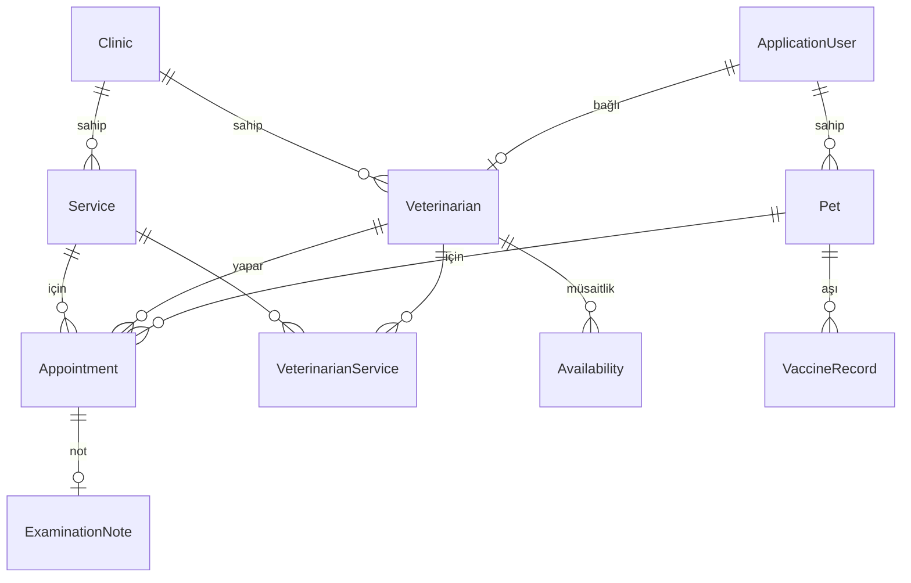

# Veteriner Kliniği Randevu ve Hasta Takip Sistemi

**Öğrenci Numarası:** ogrencinumarasi
**Ad Soyad:** Ad Soyad
**Ders Grubu:** (Ders grubunu buraya yazınız)
**GitHub Bağlantısı:** https://github.com/kullaniciadi/VeterinerKlinigi

---

## 1. Proje Tanıtımı

Bu proje, **Web Programlama** dersi kapsamında geliştirilen bir **Veteriner Kliniği Randevu ve Hasta Takip Sistemi**'dir. ASP.NET Core MVC (.NET 10 LTS) kullanılarak geliştirilmiştir.

Sistem; veteriner kliniklerinin sunduğu hizmetleri, veteriner hekimlerin uzmanlık alanlarını, evcil hayvanların muayene ve aşı geçmişini ve hayvan sahiplerinin randevularını yönetebilmektedir. Ayrıca uygulama, kendi işlevlerini bir yapay zekâ asistanının (Claude Desktop, VS Code, MCP Inspector vb.) çağırabileceği araçlar olarak sunan bir **MCP (Model Context Protocol) sunucusu** içermektedir. Böylece hayvan sahibi bir yapay zekâ asistanına "Pamuk'un bir sonraki aşısı ne zaman?" diye sorduğunda asistan cevabı doğrudan bu uygulamadan alabilmektedir.

### Temel Özellikler

- **Klinik ve Hizmet Yönetimi:** Klinik tanımlama, çalışma saatleri, hizmetler (muayene, aşı, kısırlaştırma, diş temizliği, tıraş ve bakım) ile süre ve ücret bilgileri.
- **Veteriner Hekim Yönetimi:** Uzmanlık alanları, verebildiği hizmetler ve haftalık müsaitlik saatleri.
- **Hayvan Sahibi ve Evcil Hayvan:** Üye olma, birden fazla evcil hayvan kaydı, tür/ırk/doğum tarihi/kilo/fotoğraf ve aşı kayıtları.
- **Randevu Sistemi:** Hekim müsaitliği ve çakışma kontrolü (hizmet süresi dahil), onay mekanizması (Bekliyor → Onaylandı/Reddedildi → Tamamlandı), muayene notu.
- **REST API:** LINQ sorguları ile filtreleme, DTO dönüşü, doğru HTTP durum kodları.
- **MCP Sunucusu:** En az üç araç (uygun_saatler, asi_takvimi, randevu_olustur), yetkilendirme ile korunur, yalnızca ilgili kullanıcının verisini döndürür.
- **Rol Bazlı Yetkilendirme:** Admin, Veteriner, Üye (en az üç rol).
- **Admin Paneli:** İstatistikler ve kullanıcı/rol yönetimi.

### Kullanılan Teknolojiler

- ASP.NET Core MVC (.NET 10 LTS)
- C#
- SQLite (Entity Framework Core, Code First, Migration)
- ASP.NET Core Identity
- ModelContextProtocol.AspNetCore (MCP C# SDK)
- Bootstrap 5, HTML5, CSS3, JavaScript, jQuery

---

## 2. Veritabanı Modeli (ER Diyagramı)



### Ana Varlıklar

| Varlık | Açıklama |
|---|---|
| **Clinic** | Klinik (ad, adres, telefon, e-posta, çalışma saatleri) |
| **Service** | Hizmet (ad, süre, ücret, klinik) |
| **Veterinarian** | Veteriner hekim (ad, uzmanlık, klinik, aktiflik) |
| **VeterinarianService** | Hekim–Hizmet eşleşmesi (N-N) |
| **Availability** | Hekimin haftalık müsaitlik aralığı |
| **ApplicationUser** | Identity kullanıcısı (Admin/Veteriner/Üye) |
| **Pet** | Evcil hayvan (ad, tür, ırk, doğum tarihi, kilo, fotoğraf, sahip) |
| **VaccineRecord** | Aşı kaydı (aşı adı, yapılma tarihi, sonraki doz) |
| **Appointment** | Randevu (hayvan, hizmet, hekim, tarih/saat, süre, ücret, durum) |
| **ExaminationNote** | Muayene notu (randevuya bağlı) |

---

## 3. Kurulum ve Çalıştırma

### Gereksinimler
- .NET 10 SDK
- (Opsiyonel) Visual Studio 2022 / VS Code

### Adımlar
```bash
# 1. Depoyu klonlayın
git clone https://github.com/kullaniciadi/VeterinerKlinigi.git
cd VeterinerKlinigi

# 2. Veritabanını oluşturun (migration'lar otomatik uygulanır)
dotnet ef database update

# 3. Uygulamayı çalıştırın
dotnet run
```

Uygulama varsayılan olarak `http://localhost:5080` adresinde çalışır.

### Örnek Kullanıcılar (Seed Verisi)

| Rol | E-posta | Şifre |
|---|---|---|
| Admin | ogrencinumarasi@sakarya.edu.tr | sau |
| Veteriner | dr.elif@patilidostlar.example | Vet123! |
| Üye | pamuk.sahibi@example.com | Uye123! |

---

## 4. REST API Uçları

Tüm uçlar `/api` öneki ile sunulur ve kimlik doğrulama (cookie) gerektirir.

### Veterinerler

| Metod | Uç | Açıklama |
|---|---|---|
| GET | `/api/veterinarians` | Tüm aktif veterinerleri listeler |
| GET | `/api/veterinarians/{id}` | Tek veteriner detayı |
| GET | `/api/veterinarians/available?serviceId=&date=` | Seçilen hizmet ve tarihte uygun veterinerler (LINQ) |
| GET | `/api/veterinarians/{id}/slots?serviceId=&date=` | Veterinerin müsait saatleri |

### Evcil Hayvanlar

| Metod | Uç | Açıklama |
|---|---|---|
| GET | `/api/pets/mine` | Oturum açan kullanıcının evcil hayvanları |
| GET | `/api/pets/{id}/vaccines` | Bir evcil hayvanın aşı geçmişi ve yaklaşan aşıları (LINQ) |
| GET | `/api/pets/upcoming-vaccines?daysAhead=30` | Yaklaşan aşıları olan hayvanlar (admin/veteriner) |

### Randevular

| Metod | Uç | Açıklama |
|---|---|---|
| GET | `/api/appointments/mine` | Kullanıcının randevuları (LINQ) |
| POST | `/api/appointments` | Yeni randevu oluşturur (durum: Bekliyor) |
| GET | `/api/appointments/veterinarian` | Veterinerin kendi randevuları |
| POST | `/api/appointments/{id}/approve` | Randevuyu onaylar |
| POST | `/api/appointments/{id}/reject` | Randevuyu reddeder |

### Raporlar

| Metod | Uç | Açıklama |
|---|---|---|
| GET | `/api/reports/by-service?from=&to=` | Her hizmet türü için randevu sayısı ve ciro (LINQ) |

### Örnek İstek / Cevap

**İstek:**
```http
GET /api/veterinarians/available?serviceId=1&date=2026-11-20 HTTP/1.1
Host: localhost:5080
Cookie: .AspNetCore.Identity.Application=...
```

**Cevap (200 OK):**
```json
[
  {
    "id": 1,
    "fullName": "Dr. Elif Yılmaz",
    "specialties": "Küçük Hayvan, Dermatoloji",
    "clinicId": 1,
    "clinicName": "Patili Dostlar Veteriner Kliniği",
    "services": ["Genel Muayene", "Aşı Uygulama", "Diş Temizliği", "Tıraş ve Bakım"]
  }
]
```

**İstek (randevu oluşturma):**
```http
POST /api/appointments HTTP/1.1
Content-Type: application/json
Cookie: .AspNetCore.Identity.Application=...

{
  "petId": 1,
  "serviceId": 1,
  "veterinarianId": 1,
  "appointmentDate": "2026-11-20T09:00:00",
  "notes": "Kontrol"
}
```

**Cevap (201 Created):**
```json
{
  "success": true,
  "message": "Randevunuz başarıyla oluşturuldu ve onay bekliyor.",
  "appointmentId": 1
}
```

---

## 5. MCP (Model Context Protocol) Sunucusu

MCP uç noktası: `http://localhost:5080/mcp` (Streamable HTTP). Yetkilendirme ile korunur; araçlar yalnızca oturum açan kullanıcının verisini döndürür.

### Sunulan Araçlar

| Araç | Parametreler | Açıklama |
|---|---|---|
| `uygun_saatler` | `hizmetId` (int), `tarih` (string, yyyy-MM-dd) | O gün boşta olan hekim ve saatleri listeler |
| `asi_takvimi` | `hayvanAdi` (string) | Evcil hayvanın geçmiş ve yaklaşan aşılarını döner |
| `randevu_olustur` | `hayvanAdi`, `hizmetId`, `veterinerId`, `tarih` | "Bekliyor" durumunda randevu oluşturur; çakışma varsa nedenini açıklar |

Tüm araçlar MVC sayfaları ve REST API ile **aynı servis katmanını** kullanır (iş kuralları tek yerde).

### MCP Inspector ile Test

1. Uygulamayı çalıştırın ve tarayıcıdan giriş yapın (cookie alın).
2. MCP Inspector'ı çalıştırın: `npx @modelcontextprotocol/inspector`
3. Transport: **Streamable HTTP**, URL: `http://localhost:5080/mcp`
4. Headers bölümüne tarayıcıdan aldığınız `Cookie` değerini ekleyin.
5. "Connect" → "List Tools" ile araçları görüntüleyin ve çağırın.

**Örnek çağrı (`asi_takvimi`):**
```json
{
  "jsonrpc": "2.0",
  "id": 1,
  "method": "tools/call",
  "params": {
    "name": "asi_takvimi",
    "arguments": { "hayvanAdi": "Pamuk" }
  }
}
```

**Örnek cevap:**
```json
{
  "result": {
    "content": [
      {
        "type": "text",
        "text": "Pamuk (Kedi - Tekir) aşı takvimi:\n- Kuduz (Yapılma: 15.01.2026) -> Sonraki doz: 15.01.2027\n- FVRCP (Yapılma: 15.01.2026) -> Sonraki doz: 20.12.2026"
      }
    ]
  }
}
```

---

## 6. Ekran Görüntüleri

> Ekran görüntülerini `docs/screenshots/` klasörüne ekleyiniz:
> - `home.png` – Anasayfa
> - `login.png` – Giriş sayfası
> - `pets.png` – Evcil hayvan listesi
> - `appointment-create.png` – Randevu oluşturma
> - `admin.png` – Admin paneli
> - `mcp-inspector.png` – MCP Inspector'dan araç çağrısı

---

## 7. Proje Yapısı

```
VeterinerKlinigi/
├── Controllers/        # MVC ve API controller'ları
│   └── Api/            # REST API controller'ları
├── Data/               # DbContext ve DbSeeder
├── Mcp/                # MCP araçları (VeterinerMcpTools)
├── Migrations/         # EF Core migration'ları
├── Models/             # Varlık sınıfları
├── Services/           # İş (servis) katmanı + DTO'lar
├── Views/              # Razor view'ları
├── wwwroot/            # Statik dosyalar (Bootstrap, jQuery)
├── Program.cs
├── appsettings.json
└── README.md
```

---

## 8. Teslim Notu (SABİS)

SABİS'e yalnızca bir `.txt` dosyası yüklenecektir. Dosya üç satırdan oluşmalıdır:

```
ogrencinumarasi
Ad Soyad
https://github.com/kullaniciadi/VeterinerKlinigi
```

---

## 9. Lisans

Bu proje eğitim amaçlı geliştirilmiştir.